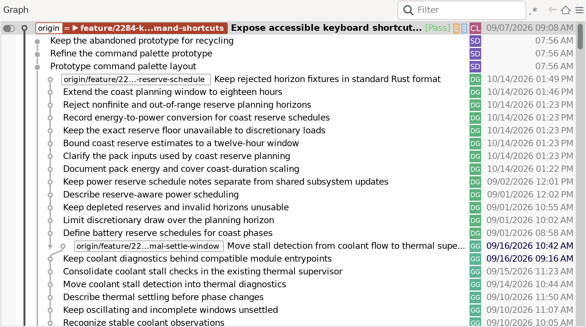

# Graph View

The **Graph** displays the log graph ("history") starting from the selected **Branches** anchors.
Branches, tags, and other *refs* will appear at the "appropriate" commits.
In the case of File (or Subtree) Logs or filtered Logs (see **Filter** input field below), each *ref* will be mapped to the most recent commit in the Graph that is still part of the ref's history.
For File (or Subtree) Logs, the content of the file (or subtree) at the mapped ref commit will be identical to the content of the actual commit to which the ref points.
For filtered Logs, when there is no relation between the mapped commit and the actual commit, you can still see which of your filtered commits are part of each ref's history.
Mapped refs that are not located exactly at the commit to which they are attached will be denoted by `~`.

- [Variants of the Graph View](#variants-of-the-graph-view)
- [Display options](#display-options)
- [How to read the graph view](#how-to-read-the-graph-view)

## Variants of the Graph View

- The **Graph View** is the primary focus of the **Log Window** (Main Window).
  **Query \| Log** is a shortcut to the **Graph View** in the **Log Window**.
- The **Graph View** in the **Standard Window** is similar, but since there is no branch selector, you can only visualize the current branch or all branches when the 'My History' tab is open.
- The **Journal View** of the **Working Tree Window** shows only the commit history of the current HEAD commit.

## Display Options

The **Graph** can be customized in various ways using the **Options** hamburger icon above the **Graph View**.
Please note that not all options are available in every view.
- **Columns** - Adjust the columns shown in the Graph View.
  You can toggle the Commit SHA ID, the date the commit was created, the committer/author and the [**Overlap Column**](Overlap.md)
- **Avatar** - Displays either the author or committer, depending on the **Columns** selection.
  Options include avatar only, initials, full name, and name with email.
- **Show Auxiliary Branch** (**Working Tree Journal View** only) - Allows selection of one additional branch to view in the Journal graph.
- **Show More Commits** (**Working Tree Journal View** only) - Extends the number of commits shown at the bottom of the Journal graph.
  This is temporary; when the view is refreshed the commits shown will revert to the original number.
- **Show Common Commits** (**Working Tree Journal View** only) - Hides commits not common to both the Working Tree and the selected Auxiliary branch.
  Use this option only when an Auxiliary branch has been selected.
- **Show Branch Labels** (**Working Tree Journal View** only) - Toggles visibility of branch labels.
- **Show only Selected Branches and Tags** (**Log Window Graph View** only) - Hides branch labels not selected in the **Branches View**.

*Graph View in the Log Window, with the Recyclable Commits option enabled*

### Graph filter

Using the **Filter** field above the **Graph**, you can restrict displayed commits to those matching a specific filter criterion.
When the **Filter** field is modified, SmartGit will restart the search from the selected **Branches** and return matching commits incrementally.
The search is performed directly in the repository, so eventually, SmartGit will find all matching commits in the entire repository.

## How to read the graph view

Start by locating your working tree and checked-out commit.
Then follow the connecting lines to understand the history and compare the branch labels to see what needs to be integrated.

### Locate your working tree and HEAD

The working-tree entry shows where uncommitted changes sit relative to the commit history.
Its status icon distinguishes a clean working tree from one with changes or conflicts.

The **HEAD** marker identifies the checked-out commit.
The highlighted row is the current selection, which can be a different commit.
Selecting a row lets you inspect a commit without checking it out or moving **HEAD**.

### Follow commits and their parents

Each node represents a commit, and the connecting lines lead to its parents.
When two lines share an ancestor, they show separate lines of development, even if the original branch names have since been deleted.
A merge commit connects to two or more parents and combines their histories.

Some parent histories can be collapsed to keep the graph compact.
Use the expand control to reveal the hidden commits; expanding the display does not change the repository.

A signature marker identifies a signed commit.
The marker alone does not establish that the signature is trusted.
See [SSH commit signature verification](../../HowTos/Configuration/Setting-up-SSH-commit-signing.md#verification-in-smartgit) for verification steps.

### Compare local and upstream branches

Branch labels identify which commits the branches point to.
A remote-tracking label also includes the remote name, such as `origin` in `origin/main`.
Several labels on one node refer to the same commit; they do not represent additional commits.

For a local branch with a tracked upstream, the equality marker means that both branches point to the same commit.
When they differ, ahead (`+`) and behind (`-`) counts show commits missing from the other branch.
The paired puzzle-piece markers locate the local and upstream tips in the graph.

For example, if `main` is two commits ahead of and one behind `origin/main`, it has two local commits to publish and one incoming commit to integrate.
This describes the branch history, independently of any uncommitted working-tree changes.
Remote-tracking information reflects the last fetch; fetch again to refresh it.

You can change the upstream in the [Branches View](Branches-view.md#upstream-tracked-branch).
The appearance of tracking indicators can vary between the **Graph View** variants.
